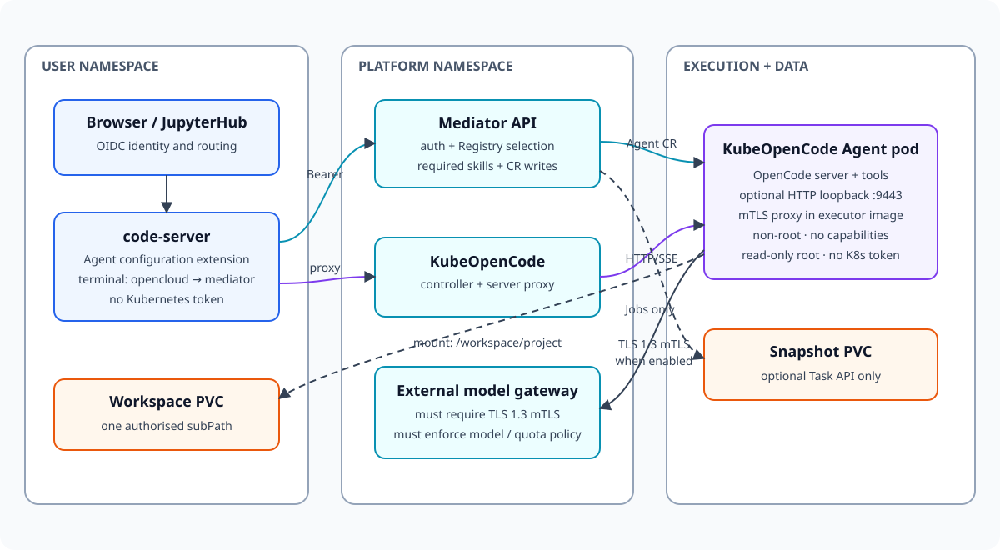

# Architecture

## Product boundary

Jupyter OpenCloud separates the developer interface from agent execution.
code-server provides the editor and terminal. The extension configures Agents
through a mediator. The `opencloud` terminal command selects one owned Agent and
uses a loopback proxy authenticated with the JupyterHub server token. OpenCode runs in a
separate, restricted Kubernetes pod that mounts only the authorised workspace.

Two loopback proxies exist on different trust paths. The code-server
`jko-attach-proxy` adds the JupyterHub credential only toward the mediator. The
Agent-side `jko-model-mtls-proxy`, when enabled, holds an image-baked client
identity and authenticates model egress to the gateway. These identities are not
derived from one another.

The extension deliberately has no Task execution, log streaming, cancellation,
or restore UI. The mediator retains those APIs for non-interactive automation,
but they are a separate client surface.



## Components

| Component | Responsibility | Trust level |
| --- | --- | --- |
| Browser and code-server | User interface and workspace editing | User-controlled |
| VS Code extension | Validate UX input and call the mediator | User-controlled |
| `opencloud` launcher | Select owned Agent and run the authenticated loopback proxy | User-controlled |
| Mediator | Authenticate identity, authorize workspace, validate configuration and write Kubernetes resources | Trusted control plane |
| JupyterHub user API | Resolve bearer token to canonical username | Identity authority |
| KubeOpenCode controller/server | Reconcile Agent CRs and proxy interactive connections | Trusted platform |
| Agent pod | Run OpenCode and commands inside the workspace sandbox | Untrusted workload |
| Model mTLS proxy | Convert pod-loopback HTTP to direct TLS 1.3 with an embedded client certificate | Secret-bearing process inside the untrusted Agent boundary |
| Model gateway | External service that must enforce client authentication and model policy | Trusted egress boundary |

## Interactive sequence

1. JupyterHub spawns code-server with its server-specific
   `JUPYTERHUB_API_TOKEN`, the mediator URL, and no Kubernetes credential.
2. The extension submits Agent configuration to the mediator.
3. The mediator authenticates the bearer token against JupyterHub and resolves
   the unique workspace owned by that username from its administrator allowlist.
4. The mediator stores the credential-free Agent configuration in a ConfigMap
   and reconciles the KubeOpenCode Agent resource.
5. In the terminal, `opencloud [agent-id]` lists only configurations returned by
   the owner-authorized mediator endpoint.
6. `KUBEOPENCODE_ENV_*` variables are validated and synchronized. A changed set
   rolls the Agent; the launcher waits for the new Deployment to be fully ready.
7. The launcher allocates an ephemeral loopback port, injects the bearer token
   toward the mediator, and executes `opencode attach` locally.
8. The mediator removes the bearer credential and proxies HTTP/SSE/WebSocket
   through the KubeOpenCode server. OpenCode commands
   execute in the Agent pod and can write only the mounted PVC subpath.

## Configuration sequence

```text
extension ─Bearer token─> mediator ─token introspection─> JupyterHub
                              │
                              ├─ ConfigMap (credential-free user settings)
                              └─ Agent CR ─> KubeOpenCode controller ─> Agent pod
```

The model credential never traverses the extension or mediator request body.
For token-based access, the Agent references an administrator-provisioned
Kubernetes Secret. For mTLS gateway access, the executor binary itself contains
an obfuscated but recoverable client certificate and private key.

## Model request sequence

When `modelMTLS` is disabled, OpenCode uses the administrator-defined model
endpoint directly. When it is enabled:

1. The mediator writes `http://127.0.0.1:9443` as the OpenCode provider base URL
   and the fixed HTTPS gateway as `MODEL_MTLS_UPSTREAM`.
2. A `postStart` hook launches the proxy from the selected executor image.
3. OpenCode and any other process in the pod can send HTTP to the loopback
   listener.
4. The proxy connects directly to the fixed gateway with TLS 1.3, verifies the
   server hostname/CA, and presents its client certificate.
5. The external gateway must map that certificate identity to allowed models,
   routes, quota, and audit policy. The NetworkPolicy supplies reachability only.

The client identity belongs to the image, not automatically to the JupyterHub
user. See [Model gateway mTLS](model-gateway-mtls.md) for the complete security
and operational implications.

## Optional Task API

The API also implements snapshot-backed Task orchestration for API clients. It
uses a workspace Lease, a protected snapshot PVC, KubeOpenCode Task resources,
and explicit restore. This path is documented in the OpenAPI specification and
tested independently; it is not reachable from the extension UI.

## State and ownership

| State | Storage | Owner |
| --- | --- | --- |
| Workspace authorization | Helm values rendered as mediator ConfigMap | Platform administrator |
| Agent profile/instructions/model/Registry selections/safe environment | Per-Agent ConfigMap | Mediator |
| Skill and plugin catalog | Namespaced KubeOpenCode Registry CR | Platform administrator; mediator read-only |
| Agent desired state | KubeOpenCode Agent CR | Mediator |
| Model and private Git credentials | Kubernetes Secret | Platform administrator |
| Embedded mTLS client identity | Encrypted bundle inside the immutable executor image binary | Platform PKI and image pipeline |
| Workspace files | User PVC subpath | User |
| Task snapshots | Separate snapshot PVC | Mediator Jobs |

## Availability and consistency

The current chart intentionally runs one mediator replica. Reconciliation is
restart-safe because Task records and Leases live in Kubernetes, but no leader
election is implemented. Do not increase the replica count until leader
election and concurrent reconciliation tests exist.

Agent environment updates are rollout-aware. The launcher verifies the desired
environment in the Deployment template and waits until old replicas are gone,
preventing attachment to a stale server pod.

The mTLS proxy is started in the Agent container by a background `postStart`
hook. It currently has no separate health probe or supervisor, so Agent readiness
does not imply that model egress is healthy.
