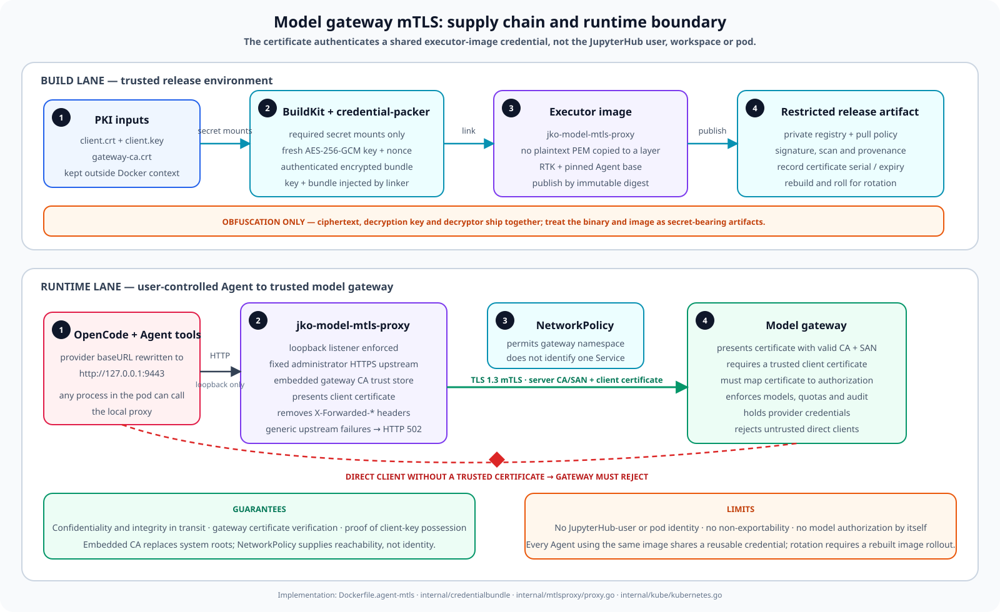

# Model gateway mTLS

`modelMTLS` adds a client-authenticated TLS hop between an Agent-local proxy
and the model gateway. It does not turn every platform connection into mTLS and
it does not bind the model request to the JupyterHub user.



## Two independent identity planes

| Plane | Credential | What it identifies | Where it is enforced |
| --- | --- | --- | --- |
| User and workspace control | JupyterHub bearer token | The canonical JupyterHub user | Mediator and JupyterHub user API |
| Model egress | Embedded client certificate and private key | The certificate identity distributed in the executor image | Model gateway TLS endpoint |

There is no cryptographic binding between these identities. Reusing one mTLS
executor image for several workspaces makes all of those Agents present the
same client certificate. The gateway cannot derive a JupyterHub username,
workspace, pod, or Agent ID from that certificate unless the platform issues a
distinct certificate and deploys a corresponding image for that scope.

The two loopback proxies also have different jobs:

- `jko-attach-proxy` authenticates code-server traffic to the mediator with the
  JupyterHub token; and
- `jko-model-mtls-proxy` authenticates model traffic from the Agent pod to the
  model gateway with a client certificate.

## Build-time credential flow

The mTLS image is built from `Dockerfile.agent-mtls` with three BuildKit secret
mounts: a client certificate, its private key, and the gateway CA bundle. The
credentials must remain outside the repository and Docker build context.

During the build:

1. `credential-packer` reads the three secret mounts.
2. It creates a fresh 256-bit AES key and nonce and seals a bounded bundle with
   AES-256-GCM.
3. The hexadecimal key and encrypted bundle are injected into the static
   `jko-model-mtls-proxy` binary through Go linker variables.
4. Only that binary is copied into the final executor image; the PEM files are
   not copied into a final image layer.

This prevents PEM blocks and certificate subjects from being visible in a text
editor or a basic `strings` scan. It is obfuscation, not secret storage: the
decryption key, ciphertext, and decryptor are all in the same binary. A user who
can read the executor binary can copy it, reverse engineer it, or exercise its
client identity through the local proxy. Treat the final binary, image, image
cache, SBOM/provenance attachments, and registry access as secret-bearing.

The packer accepts three non-empty files of at most 64 KiB each. It does not
validate certificate expiry, Extended Key Usage, trust, or hostname. The proxy
detects a malformed client certificate/key pair or empty CA bundle only when it
starts.

## Runtime request path

For a workspace with `modelMTLS: true`, the mediator generates this behavior:

1. Configuration validation requires an HTTPS `openCodeBaseUrl` without
   embedded credentials and a non-empty `executorImage`.
2. OpenCode's `model-proxy` provider is pointed at
   `http://127.0.0.1:9443`, not at the remote gateway.
3. `MODEL_MTLS_UPSTREAM` contains the administrator-owned HTTPS gateway URL.
4. A container `postStart` hook starts `jko-model-mtls-proxy` in the background
   and redirects its output to `/tmp/model-mtls-proxy.log`.
5. The proxy accepts plaintext HTTP only on loopback and opens a direct TLS 1.3
   connection to the fixed upstream. It validates the server chain and
   hostname with the embedded gateway CA and presents the embedded client
   certificate.
6. The gateway authenticates the certificate and must then independently
   authorize the route, model, quota, and audit identity.

The plaintext first hop stays inside the pod network namespace. Loopback is a
pod-reachability control, not an authorization boundary: OpenCode, user commands,
skills, plugins, and any other process in the same pod can call
`127.0.0.1:9443` and use the embedded client identity. The proxy does not
authenticate local callers or restrict gateway paths.

The proxy removes `X-Forwarded-For`, `X-Forwarded-Host`, and
`X-Forwarded-Proto`. Other application headers, including `Authorization`, are
forwarded. The gateway must derive workload identity from the verified TLS peer
certificate and treat caller-supplied identity headers as untrusted.

The Go transport deliberately sets `Proxy: nil`; it connects directly to
`openCodeBaseUrl`. The workspace `modelProxyUrl` setting does not carry this
mTLS hop. DNS, routing, and NetworkPolicy must therefore permit the Agent pod to
reach the gateway directly.

## What the control does and does not guarantee

| Property | Result |
| --- | --- |
| Gateway server authentication | Enforced with the embedded CA, normal hostname/SAN verification, and TLS 1.3 minimum |
| Client certificate presentation | Offered when the gateway requests it; the gateway must require and validate it |
| Remote access to the local proxy | Refused because the listener must resolve to a loopback address |
| Fixed upstream | Enforced; it must be HTTPS and cannot contain credentials, a query, or a fragment |
| JupyterHub user identity at the gateway | Not provided by the certificate |
| Per-user or per-workspace identity | Only possible when the platform issues distinct certificates and assigns the corresponding images |
| Non-exportable private key | Not provided; the binary is a recoverable secret-bearing artifact |
| Intra-pod authorization | Not provided; every process in the pod can call the proxy |
| Model, path, or quota authorization | Not provided; `allowedModels` is an OpenCode/UI constraint, not a gateway firewall |
| Mandatory mTLS from NetworkPolicy | Not provided; NetworkPolicy controls L3/L4 reachability, not TLS client authentication |

The gateway must fail closed for direct connections without an accepted client
certificate. Otherwise an Agent process can bypass the local proxy and call the
gateway over the NetworkPolicy-allowed route.

## Configure an mTLS workspace

Build one image for each intended gateway identity and publish it to a private
registry. Use immutable digests in production:

```sh
make agent-mtls-image \
  MTLS_CLIENT_CERT=/secure/alice/client.crt \
  MTLS_CLIENT_KEY=/secure/alice/client.key \
  MTLS_GATEWAY_CA=/secure/gateway/ca.crt \
  MTLS_AGENT_IMAGE=registry.example.com/platform/jko-agent-mtls-alice:VERSION
docker push registry.example.com/platform/jko-agent-mtls-alice:VERSION
```

Then configure the administrator-owned workspace entry:

```yaml
openCodeBaseUrl: https://model-gateway.model-gateway.svc.cluster.local
openCodeModel: model-proxy/approved-model
allowedModels: [model-proxy/approved-model]
modelMTLS: true
executorImage: registry.example.com/platform/jko-agent-mtls-alice@sha256:REPLACE_WITH_DIGEST
```

The mediator currently checks that `executorImage` is non-empty; it cannot
prove that the image contains the proxy or the intended certificate. Render the
Agent, inspect the deployed image digest, and execute the mTLS acceptance tests
before onboarding users.

### KubeOpenCode v0.1.9 Task pods

The pinned controller applies `Agent.spec.podSpec.lifecycle` to both the
persistent Agent server and `agentRef` Task pods. However, an `agentRef` Task
runs an attach client; model execution and the gateway request remain in the
persistent Agent. The `attachImage` therefore does not need the proxy or client
certificate. Adding them would duplicate a recoverable identity into more pods.

The current lifecycle command backgrounds the proxy. If the lightweight
`attachImage` lacks the binary, that background child can write an error while
the hook itself still returns success; `FailedPostStartHook` is not reliable
evidence. Keep the attach image credential-free, test the Task path, and inspect
its logs until the lifecycle can be scoped to the persistent Agent upstream or
in this adapter.

## Gateway contract

The gateway is the authorization boundary and must:

- serve a certificate whose SAN matches `openCodeBaseUrl` and whose chain is
  rooted in the embedded gateway CA;
- require TLS 1.3 and a client certificate signed by the dedicated client CA;
- map an exact certificate identity, SAN/URI, or fingerprint to the permitted
  models, routes, rate limits, and spend quota;
- reject missing, expired, revoked, or unrecognized client certificates;
- ignore caller-supplied identity and forwarding headers for authorization;
- record the authenticated certificate identity without logging prompts,
  provider responses, bearer tokens, private keys, or full request bodies; and
- expose certificate-expiry and authentication-failure monitoring.

Signing a certificate with the accepted client CA is authentication only. It is
not sufficient authorization when several teams or workspaces have different
model policies.

## Rotation and compromise response

BuildKit secret contents do not participate in the build cache key. A rotation
must force the credential-packing step to run again; use a no-cache build or an
equivalent verified cache-busting mechanism.

1. Issue the new client certificate or gateway CA bundle.
2. Build with `--no-cache`, publish a new immutable digest, and verify that the
   gateway observes the new certificate fingerprint.
3. Update `executorImage`; do not copy the identity into `attachImage`.
4. Wait for every persistent Agent to use the new digest.
5. Revoke the old client certificate, block the old image digest, and terminate
   remaining pods or connections using it.

For a gateway CA rotation, first publish an image trusting both old and new CA
certificates, rotate the gateway certificate, then publish a second image that
removes the old CA.

If the image or binary is disclosed, deleting a Kubernetes Secret does not
revoke it because the private key is not read from a runtime Secret. Revoke the
client certificate at the gateway, deny the old digest, rotate the identity,
and restart affected workloads.

## Failure behavior and monitoring

The proxy is launched as a background process by `postStart`. It has no
dedicated Kubernetes readiness/liveness probe and is not supervised after the
hook exits. An Agent can therefore remain Ready while model calls fail.

| Symptom | Likely cause or evidence |
| --- | --- |
| Local model call is connection-refused | Proxy is not listening; inspect `/tmp/model-mtls-proxy.log` and the executor image |
| Model call returns generic HTTP 502 | The proxy is running but its upstream DNS/network/TLS connection or gateway response failed |
| Agent is Ready but every model call fails | The backgrounded proxy may have exited; readiness and `FailedPostStartHook` are not reliable proxy-health signals |
| A direct gateway call without a certificate succeeds | Gateway is not enforcing the required client-auth policy |
| Gateway still sees the old certificate after rebuild | Cached build step, old image digest, or incomplete Agent rollout |

Do not add private key material, PEM blocks, request headers, prompts, or
provider bodies to diagnostics. Monitor the gateway and perform a real model
health transaction because the mediator and Agent readiness endpoints do not
cover this proxy.

The mandatory cluster tests and retained evidence are listed in
[Cluster acceptance](acceptance.md#model-gateway-mtls).

## Implementation map

| Concern | Source |
| --- | --- |
| Workspace validation | `internal/config/config.go` |
| Generated Agent, loopback base URL, environment, and lifecycle | `internal/kube/kubernetes.go` |
| TLS transport and loopback listener | `internal/mtlsproxy/proxy.go` |
| AES-GCM bundle | `internal/credentialbundle/bundle.go` |
| Build-only packer | `cmd/credential-packer/main.go` |
| Runtime proxy | `cmd/model-mtls-proxy/main.go` |
| Secret-mounted multi-stage build | `Dockerfile.agent-mtls` |
| Production example | `examples/values.production.yaml` |
