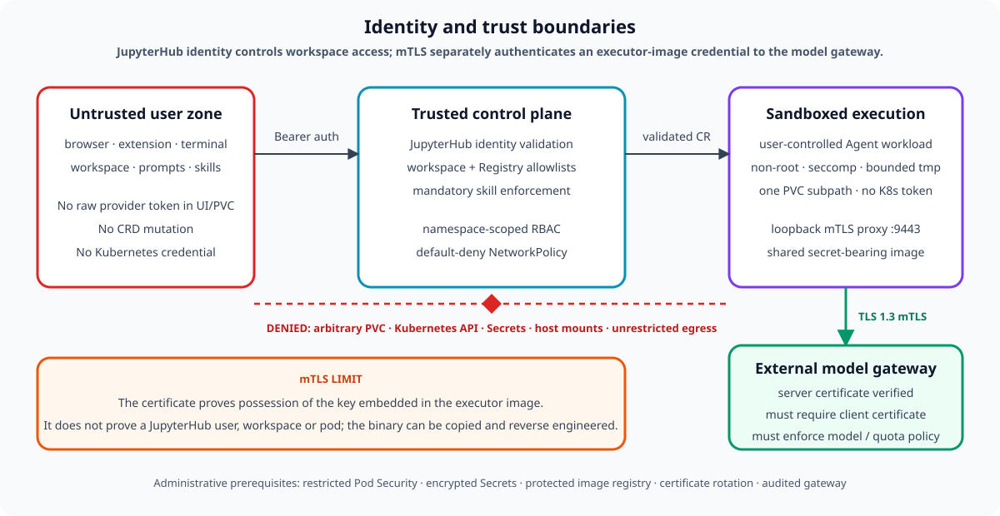
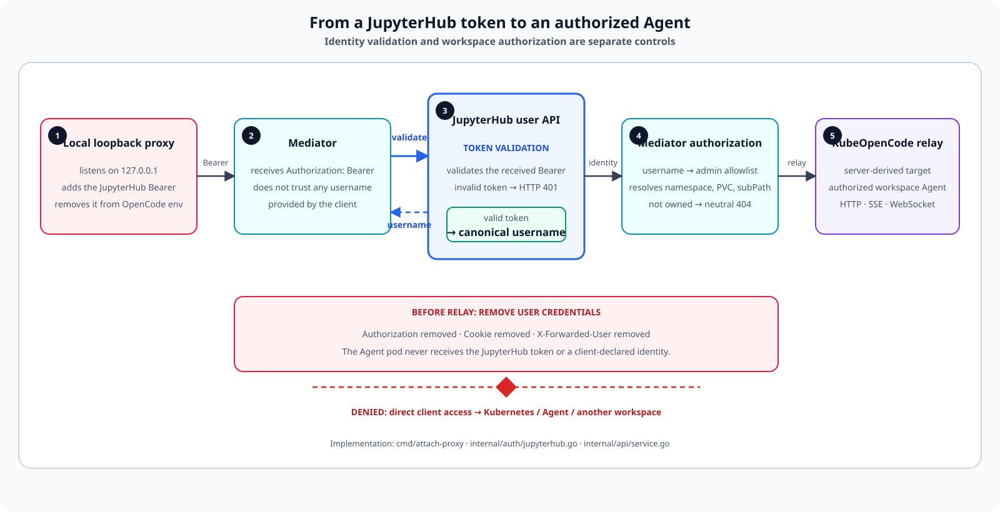
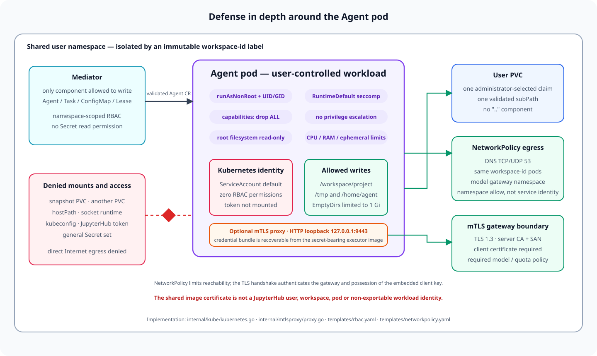
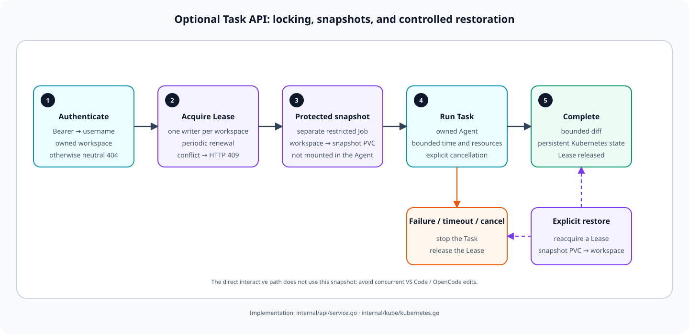

# Security model

The following implementation views show where the controls are enforced rather
than only describing the trust zones.

### Authentication and ownership flow

### Agent runtime isolation

### Transactional Task safety

## Assets and adversary

The protected assets are user workspaces, model/Git credentials, snapshots,
other tenants' identities and Kubernetes control-plane authority. Treat the
browser, extension, terminal, workspace files, Agent prompts, skill repositories
and commands generated by OpenCode as untrusted.

OpenCode session sharing and AI SDK OpenTelemetry are disabled. The runtime
exposes only the administrator-defined `model-proxy` provider and does not
download the public model catalog.

The design addresses a malicious or compromised user workload. It does not
protect against a malicious cluster administrator, compromised Kubernetes
control plane, compromised JupyterHub identity provider, or a container-runtime
escape.

## Enforced boundaries

- JupyterHub is the canonical identity source. The mediator never trusts a
  username, namespace, PVC, or Agent resource name supplied by the client.
- The workspace mapping is an administrator-owned allowlist.
- The code-server pod has ServiceAccount automount disabled and no kubeconfig.
  Its JupyterHub token reaches only the mediator, which resolves the canonical
  username and performs all Kubernetes operations.
- Only the mediator writes Agent/Task resources and credential-free state.
- Agent and Task pods use a zero-permission ServiceAccount with token automount
  disabled.
- Agent containers run non-root, drop all capabilities, forbid privilege
  escalation, use RuntimeDefault seccomp and a read-only root filesystem.
- Writable temporary volumes and CPU, memory, ephemeral storage and duration
  are bounded.
- The Agent mounts one configured PVC subpath. It never mounts the snapshot PVC,
  JupyterHub token, kubeconfig, node socket, host path, or general Secret set.
- NetworkPolicy is default-deny and uses immutable workspace labels to separate
  users sharing a namespace. It allows only the mediator relay, DNS, and the
  selected model gateway. Kubernetes policies cannot filter DNS names;
  external providers must be reached through an egress gateway.

## Secrets

Model and private Git credentials are created by administrators as Kubernetes
Secrets and referenced by name. They are not accepted by the extension API,
terminal forwarding, Helm values, ConfigMaps, workspace PVC, or logs.

The mediator logs identifiers and bounded errors only. It must never log bearer
headers, prompts, request bodies, provider responses, URLs with query strings,
or environment values.

## Residual risks

- Direct interactive editing has no automatic pre-session snapshot or workspace
  Lease. The same user must avoid editing the same files concurrently in VS Code
  and OpenCode. Use the optional Task API when transactional snapshot/restore is
  required.
- `ReadWriteOnce` behavior varies by CSI driver and topology. Prefer RWX or prove
  simultaneous mounts on the target cluster.
- Public Git skills execute as instructions/code in the Agent trust boundary.
  Pin immutable refs and review their content.
- KubeOpenCode uses a `v1alpha1` API. An upstream upgrade may alter security or
  schema semantics and requires full revalidation.
- The mediator is single-replica until leader election is implemented.

## Production requirements

Enable Kubernetes audit logs, Secret encryption at rest, Pod Security Admission
at `restricted`, image signature/digest policy, vulnerability scanning, runtime
monitoring, resource quotas, LimitRanges, and tested backup/restore for PVCs.
